### Hello there 👋 I'm fren_gor, a Spigot/PaperMC plugin developer and Rust enthusiast

- 🔭 I’m currently working on [UltimateAdvancementAPI](https://github.com/frengor/UltimateAdvancementAPI), [Libby](https://github.com/AlessioDP/libby) and [rust-cc](https://github.com/frengor/rust-cc)
- :eyes: Interested in languages and compilers
- 🙋🏻‍♂️ Developer of [MultiCore Network](https://multicore.network)
- 💬 Ask me about my projects
- 💻 Languages: ☕ Java, 🦀 Rust, PHP, C, C++, C#, HTML, CSS, JavaScript
- ⚡ Fun fact: I don't know CSS so well, but I know enough to use Bootstrap

